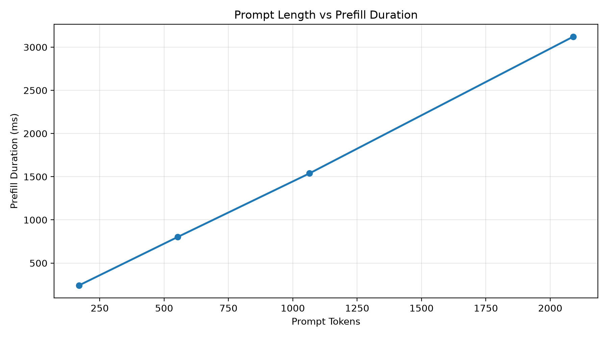
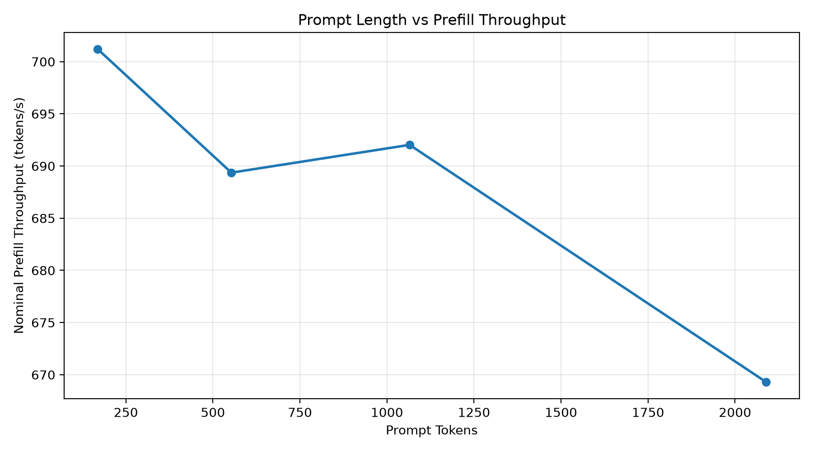
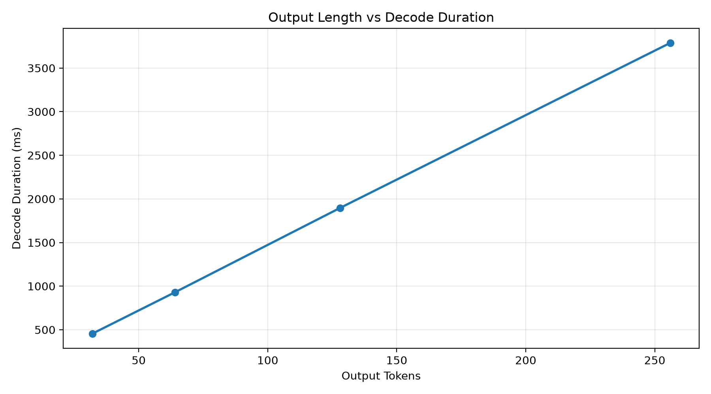
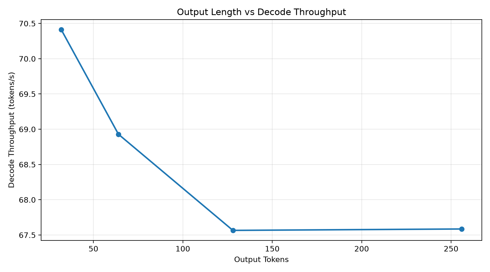

# LLM Inference Benchmark

A Python-based benchmarking framework for evaluating large language model inference performance, including request latency, throughput, concurrent execution, streaming generation, and Prefill/Decode profiling.

The project currently uses **Ollama with Qwen2.5-3B** on Apple Silicon. It is designed to support future experiments with GPU inference engines such as vLLM and SGLang.

## 1. Features

- Synchronous and asynchronous inference benchmarking
- Configurable client-side concurrency using `asyncio.Semaphore`
- Streaming latency measurement (TTFT and TPOT)
- Request throughput and output token throughput
- Client-side queueing and request lifecycle visualization
- Server-side Prefill and Decode profiling using the Ollama native API
- CSV export and performance visualization

## 2. Environment

| Component | Configuration |
|---|---|
| Hardware | Apple M2 Pro, 16 GB unified memory |
| Operating System | macOS |
| Model | Qwen2.5-3B |
| Inference Backend | Ollama |
| Programming Language | Python |
| API | OpenAI-compatible API and Ollama native API |

The reported measurements were obtained from local experiments. Results may vary with hardware configuration, backend settings, model state, and workload.

## 3. Performance Metrics

| Metric | Description |
|---|---|
| Latency | Time required to complete an inference request |
| TTFT | Time to First Token (first non-empty streamed content) |
| TPOT | Average time per output token after the first token |
| Request Throughput | Successfully completed requests per second |
| Output Throughput | Generated output tokens per second |
| Prefill Duration | Server-reported prompt evaluation time |
| Decode Duration | Server-reported output evaluation time |

## 4. Experiments

### 4.1 Concurrent Inference Benchmark

Client concurrency levels: 1, 2, 4, and 8.

The experiments evaluate the relationship between concurrency, latency, queueing, and throughput.

Under the tested workload, increasing Ollama's configured server parallelism from 1 to 4 improved throughput at higher client concurrency.

However, increasing client concurrency beyond the server's effective processing capacity produced diminishing throughput gains and substantially higher TTFT.

### 4.2 Request Lifecycle Analysis

Each request is divided into three observable stages:

1. Client queueing before acquiring a semaphore.
2. Waiting for the first non-empty streamed response.
3. Streaming output until request completion.

The timeline visualizations illustrate how waiting time shifts between client-side queueing and the API response stage under different concurrency settings.

### 4.3 Prefill Benchmark

Input lengths were varied while keeping the output short.

| Prompt Tokens | Mean Prefill Duration |
|---|---:|
| 169 | 241.02 ms |
| 553 | 802.19 ms |
| 1065 | 1538.96 ms |
| 2089 | 3121.15 ms |

Within the tested range, Prefill duration increased approximately linearly with input length.

The nominal Prefill throughput was approximately 669–701 tokens/s. Some requests reused cached prompt tokens, so these values should not be interpreted as uncached processing throughput.





### 4.4 Decode Benchmark

Output length was varied while keeping the input prompt fixed.

| Output Tokens | Mean Decode Duration | Mean Decode Throughput |
|---|---:|---:|
| 32 | 454.48 ms | 70.41 tokens/s |
| 64 | 928.62 ms | 68.93 tokens/s |
| 128 | 1895.74 ms | 67.57 tokens/s |
| 256 | 3788.35 ms | 67.59 tokens/s |

Decode duration increased approximately proportionally to output length, while generation throughput remained relatively stable at approximately 68–70 tokens/s.





## 5. Installation

Clone the repository and create a Python virtual environment:

```bash
git clone https://github.com/ysi67107-bit/llm-inference-benchmark
cd llm-inference-benchmark

python3 -m venv .venv
source .venv/bin/activate

python -m pip install -r requirements.txt
```

Start Ollama and ensure that the `qwen2.5:3b` model is available:

```bash
ollama pull qwen2.5:3b
ollama list
```

## 6. Running Benchmarks

Run the concurrent inference benchmark:

```bash
python scripts/run_concurrent.py
```

Run the streaming concurrency benchmark:

```bash
python scripts/run_streaming_concurrent.py
```

Run the server-side Prefill benchmark:

```bash
python scripts/run_native_prefill.py
```

Run the server-side Decode benchmark:

```bash
python scripts/run_decode_benchmark.py
```

Generate performance figures:

```bash
python scripts/plot_prefill.py --input results/native_prefill_<timestamp>.csv
python scripts/plot_decode.py --input results/native_decode_<timestamp>.csv
```

Replace `<timestamp>` with the corresponding result file timestamp.

## 7. Limitations

- Experiments were performed on a single Apple Silicon machine.
- The current backend is Ollama; results should not be generalized to vLLM or SGLang.
- Some measurements may be influenced by prompt caching.
- TTFT includes client-side and server-side overhead, not only Prefill computation.
- TPOT is an end-to-end streaming approximation and is not identical to server-side Decode time.
- The current experiments use relatively small workloads and limited repetitions.

## 8. Future Work

- Add structured experiment configuration and metadata logging.
- Improve statistical reporting and repeatability.
- Extend benchmarking to NVIDIA GPU environments.
- Compare Ollama, vLLM, and SGLang under controlled workloads.
- Investigate KV Cache management, batching, scheduling, and long-context performance.

## 9. Project Status

Initial implementation completed:

- Concurrency benchmarking
- Streaming performance measurement
- Request lifecycle visualization
- Prefill profiling
- Decode profiling

Further reproducibility improvements and multi-backend experiments are planned.
